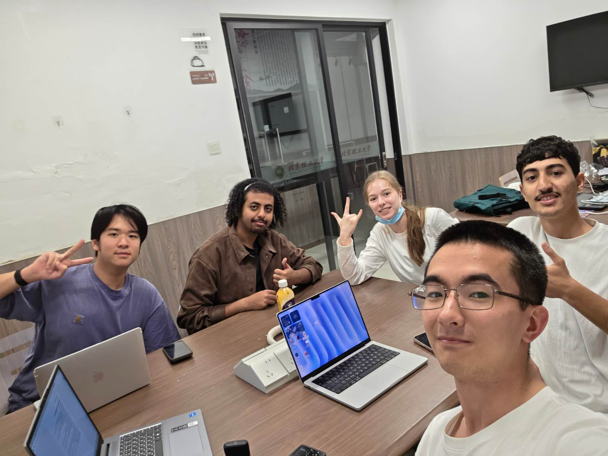

# Meeting Summary - October 19, 2026

**Date**: October 19, 2026
\
**Time**: 15:40 – 17:23
\
**Location:** 24HR Study Point (24HR阅读交互空间)
\
**Attendees:** 
\
\- KHO EDUARD 1820262087 (@Infektt),
\
\- 梁启德 1820262075 (@Solgitt), 
\
\- KHOJANOVA ALINA 1820262100 (@), 
\
\- AL-HATTAMI HAMID SALEEM NAEL 1820262063 (@alhattamihameed2-collab), 
\
\- HAKAMI QASEM NABIL QASEM 1820262088 (@Bn1adn)

## Agenda / Purpose
- Explain the basic workflow.
- Fast introduction to VS Code.
- Complete the initial repository setup and cloning.

## Key Discussion Points
- Explained basic VS Code interface, specifically showing how to crreate new files and folders and preview files.
- Demonstrated how to clone the repository locally and make the first commit.

## Decisions and Outcomes
- **Decision:** The team agreed to follow the VS Code workflow.
- **Reason:** To ensure everyone can work simultaneously without overwriting each other's files.

## Follow-up Actions
- Review `manual.md` and `manual2.md` for branches usage, logs keeping and AI usage rules — Everyone — Oct 21

 

---

## Evidence:

