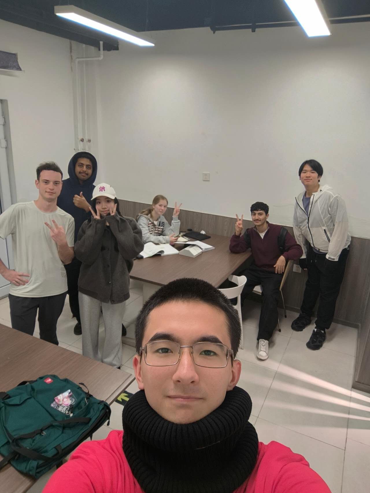

# Meeting Summary - October 26, 2026

**Date**: October 26, 2026
\
**Time**: 16:50 – 17:30
\
**Location:** 24HR Study Point (24HR阅读交互空间)
\
**Attendees:** 
\
\- KHO EDUARD 1820262087 (@Infektt),
\
\- 梁启德 1820262075 (@Solgitt), 
\
\- KHOJANOVA ALINA 1820262100 (@alinaalinok1532-eng), 
\
\- AL-HATTAMI HAMID SALEEM NAEL 1820262063 (@alhattamihameed2-collab), 
\
\- HAKAMI QASEM NABIL QASEM 1820262088 (@Bn1adn),
\
\- 谢美美 1820262040 (@lxnawnk),
\
\- MARGARIT SERBAN ALEXANDRU 1820262117 (@17671).

## Agenda / Purpose:
- Discuss Stage 1 assignment review.
- Discuss Stage 1 last assignment requirements.
- Decide current follow-ups and urgent tasks.

## Key Discussion Points:
- Explained the review result, resubmission deadline, and resubmission requirements.
- Cleared up the intial misunderstanding about `study-guide` and `contents` folder.
- Learned the task requirements for the last stage 1 assignment.

## Decisions and Outcomes:
- **Decision:** The team understood the urgent tsaks, and will begin the preparation before recieving furter explanations.
- **Reason:** Resubmission and last task deadlines are approaching and we need to focus on finishing everything on time. 

## Follow-up Actions:
- Renew `tasks.md`. 
- Add required sections to the `README.md`.
- Properly organize and edit `project-logs` for easier usage. 
- Prepare script for the presentation and send it to visual leads as soon as possible.

 

---

## Evidence:

