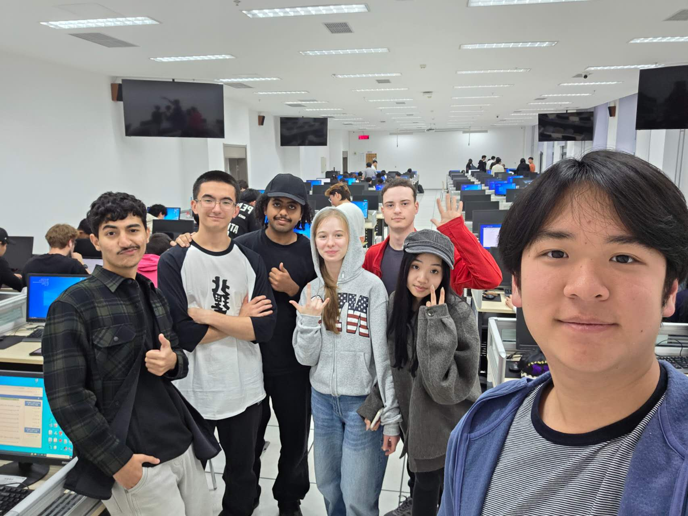

# Meeting Summary - October 26, 2026

**Date**: November 6, 2026
\
**Time**: 15:15 – 16:50
\
**Location:** Wencui, Bld. H
\
**Attendees:** 
\
\- KHO EDUARD 1820262087 (@Infektt),
\
\- 梁启德 1820262075 (@Solgitt), 
\
\- KHOJANOVA ALINA 1820262100 (@alinaalinok1532-eng), 
\
\- AL-HATTAMI HAMID SALEEM NAEL 1820262063 (@alhattamihameed2-collab), 
\
\- HAKAMI QASEM NABIL QASEM 1820262088 (@Bn1adn),
\
\- 谢美美 1820262040 (@lxnawnk),
\
\- MARGARIT SERBAN ALEXANDRU 1820262117 (@17671).

## Agenda / Purpose:
- Discuss live mini lecture details
- Check the finished outline and discuss teacher's feedback

## Key Discussion Points:
- Mini Lecture's Outline.
- Teacher's feedback on hook question.
- PPT for the mini lecture. 

## Decisions and Outcomes:
- Content lead approved lecture's outline.
- Received teacher's feedback on hook question.
- Visual lead (Alina) started working on the ppt for the mini lecture.

## Follow-up Actions:
- Finilize stage 2 submission. 
- Fix the outline to be more interesting.
- Plan rehearsals of the lecture.

 

---

## Evidence:

