# PikaByte — Project Log

**Module:** Hardware, Networks & Behaviorist AI  
**Purpose:** This document is the team's chronological diary. It records progress and completed work. It serves as proof of our workflow and contributions for the project.

## Logging Rules

1. **Chronological & Specific:** Record work as it happens. Do not write a massive summary just before the deadline. Do not write entries for empty days. Be specific (e.g., "Drafted Topic 1 CPU analogy" is acceptable; "Worked on hardware" is not).
2. **Required Fields:** Every entry must include:
   - **When?** (Date)
   - **Who?** (Name and role)
   - **What was done?**
   - **What resulted?** (Outcome)
   - **What was learned?** (Insight or difficulty)
   - **What happens next?** (Next tasks and owners)
3. **Evidence Proximity:** Paste screenshots (commits, PRs, outputs).
4. **AI Use:** Document significant AI use in the entry with these subsections:
   - **Tool & Date:** (e.g., DeepSeek, Oct 20)
   - **Purpose:** What you were trying to solve.
   - **Interactions:** Screenshots of the prompt and output.
   - **Verification:** How you checked it (what you accepted/rejected).
5. **Personal Logs:** Personal reflections and individual AI use do **NOT** go here. They must be kept in your own private Word document and submitted separately.

## Log Entries

### October 16, 2026

- **When:** October 16, 2026
- **Who:** KHO EDUARD (CEO)
- **What was done:** Created the first `README.md` with the team roster and selected module.
- **What resulted:** Created the first Markdown file of the repo. Filled in the roster and chosen module.
- **What was learned:** Practised markdown syntax. Learned how to create files and commit changes in the repo.
- **What happens next:** Read all the instructions and Write a manual for the team with the basics of workflow.
- **Evidence:** 
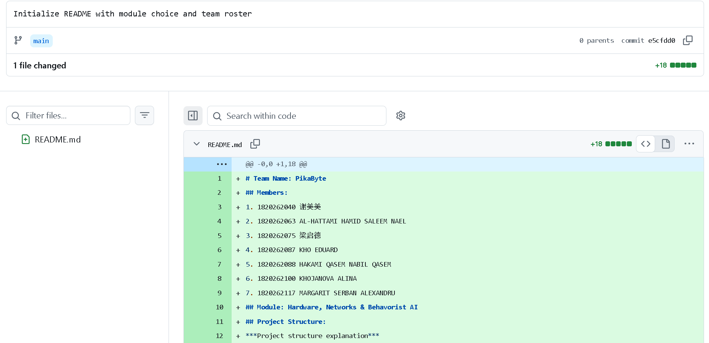
- **AI Use:** 
   - **Tool & Date:** DeepSeek, Oct 16
   - **Purpose:** Needed help with comprehending ppt0 and assignment descriptions. Also asked questions regarding GitHub fearures
   - **Interactions:** 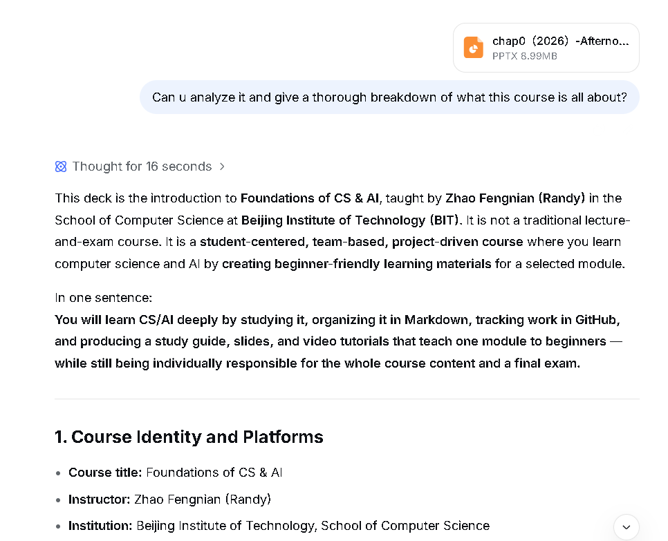
   - **Verification:** Checked the main poins in the assignment descriptions.

### October 17, 2026

- **When:** October 17, 2026
- **Who:** KHO EDUARD (CEO)
- **What was done:** Drafted the team manual (`manual.md`). Created the `assets` folder. Updated README.
- **What resulted:** The initial version of the Team Manual with roles and GitHub workflows. Created the assets folder.
- **What was learned:** Git does not see empty folders. I had to creaete a placeholder file.
- **What happens next:** Finish the manual by adding logging rules and AI usage. Refer to checklist
- **Evidence:** 
  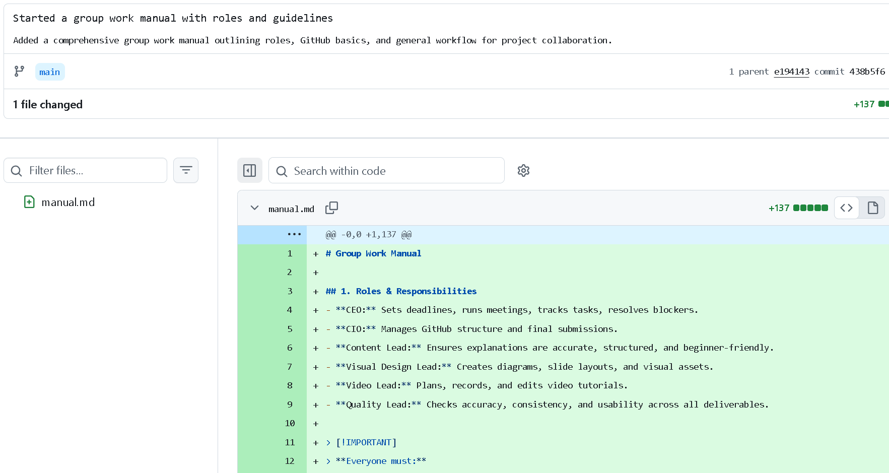
- **AI Use:** 
   - **Tool & Date:** DeepSeek, Oct 17
   - **Purpose:** Needed help with Markdown syntax.
   - **Interactions:** 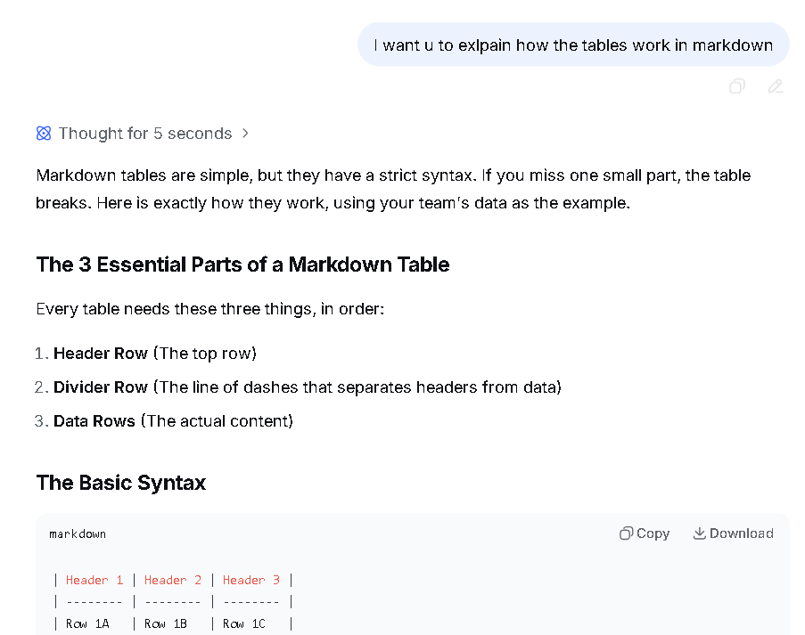
   - **Verification:** Tried making tables in the file.

### October 18, 2026

- **When:** October 18, 2026
- **Who:** KHO EDUARD (CEO)
- **What was done:** Added the initial folder structure, updated the mmanual.
- **What resulted:** The repository structure was set. Manual starts explaining VS Code workflow.
- **What was learned:** Started comprehending new VS Code workflow for a new manual.
- **What happens next:** Prepare for the first team meeting to explain VS Code and the new workflow.
- **Evidence:** 
  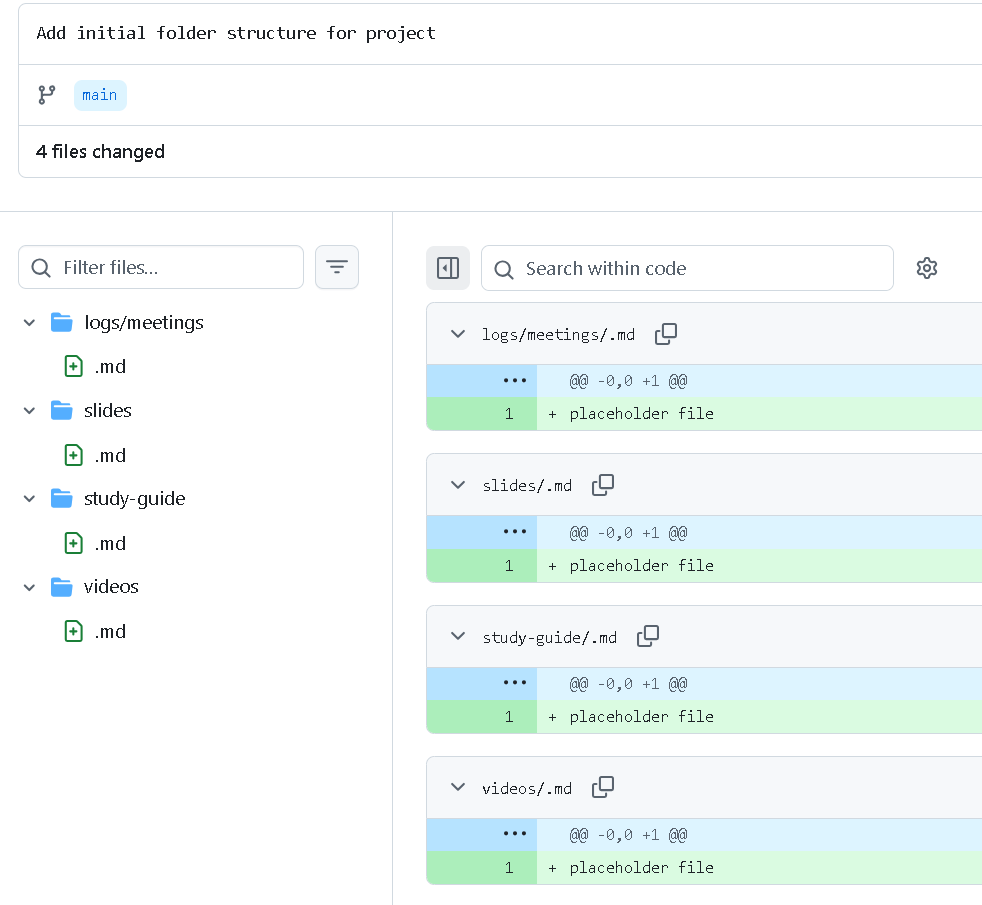
- **AI Use:** 
   - **Tool & Date:** DeepSeek, Oct 18
   - **Purpose:** Read the teacher guide to understand the VS Code workflow and figure out what to do first.
   - **Interactions:** 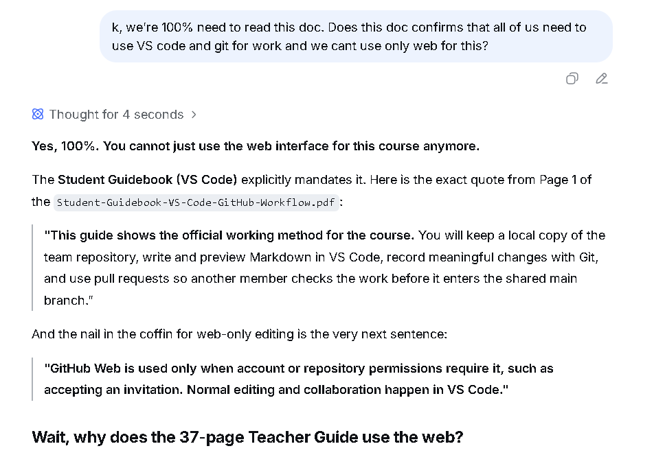
   - **Verification:** Cross-checked the AI's breakdown of the guide with the actual document.

### October 19, 2026

- **When:** October 19, 2026
- **Who:** KHO EDUARD (CEO), Solyn, Hamid, Qasem
- **What was done:** Hosted the first team meeting at 24HR Study Point. Explained the VS Code and GitHub branch workflow.
- **What resulted:** Attending members successfully cloned the repository and understood the basic branch workflow.
- **What was learned:** Explaining Git branches and pull requests takes longer than expected.
- **What happens next:** Create tasks.md, explain and start personal logs.
- **Evidence:** 
  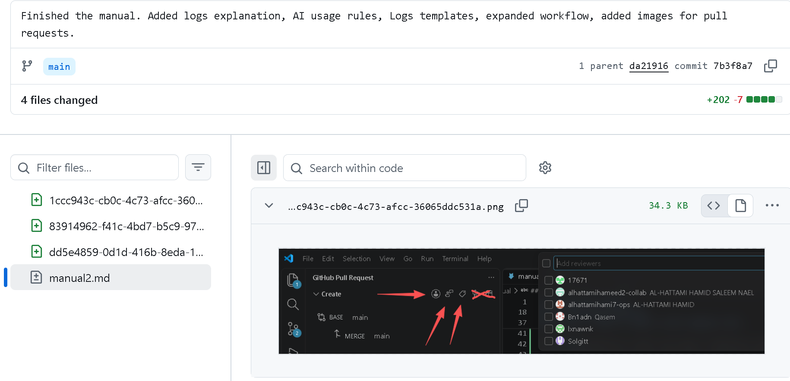

### October 20, 2026

- **When:** October 20, 2026
- **Who:** KHO EDUARD (CEO)
- **What was done:** Created `tasks.md` with the initial outline of Stage 1 tasks. Updated `README.md` with better structure. Created the first meeting log (`2026.10.19.md`). Updated `manual2.md` with image naming rules and relative path explanations. Reorganized the `/assets/` folder into subfolders (visuals, work-evidence, etc.). Fixed broken image links in the meeting log.
- **What resulted:** The repository was fully organized. All images rendered correctly, and the task list and templates were ready for the team.
- **What was learned:** Learned how to write relative paths.
- **What happens next:** Begin drafting the first topic (Computer Hardware Basics).
- **Evidence:** 
  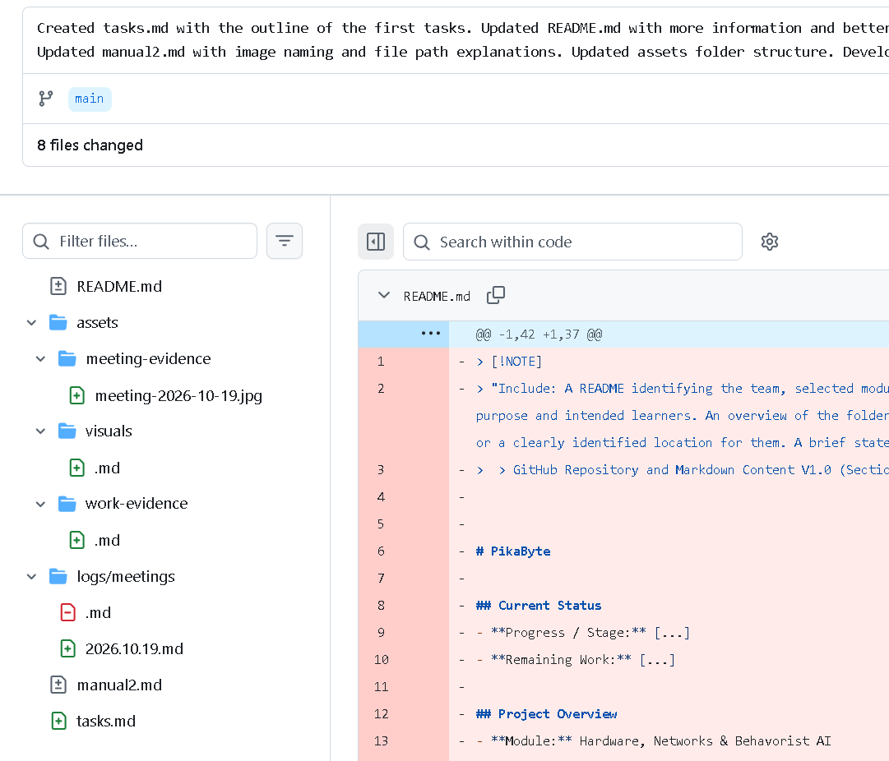
- **AI Use:** 
   - **Tool & Date:** DeepSeek, Oct 20
   - **Purpose:** Needed help debugging why images weren't rendering in the VS Code preview and organizing the asset folders to avoid naming redundancy.
   - **Verification:** Fixed the image path. Wrote the new folder structure in the README.

### October 22, 2026

- **When:** October 22, 2026
- **Who:** MARGARIT SERBAN ALEXANDRU (Content Lead)
- **What was done:** Created a draft for the second topic, "An Inside Look at How a Computer Works,". Covered information identification (bits, bytes, ASCII), external and internal components, CPU/memory functions, interrupt handling, bus types, and the step-by-step process of moving data.
- **What resulted:** Pushed the file to GitHub and opened a Pull Request for review.
- **What was learned:** Computers encode all information as binary (0s and 1s); a byte holds 8 bits and ASCII assigns numeric values to characters. I also learned how the CPU, ROM, RAM, and clock interact, and that interrupts are priority messages that override current processes. Throughput depends on architecture, clock cycles, bus size, and processing power.
- **What happens next:** Solgitt (Quality Lead) will review the file by October 24. Once approved.
- **Evidence:** 
  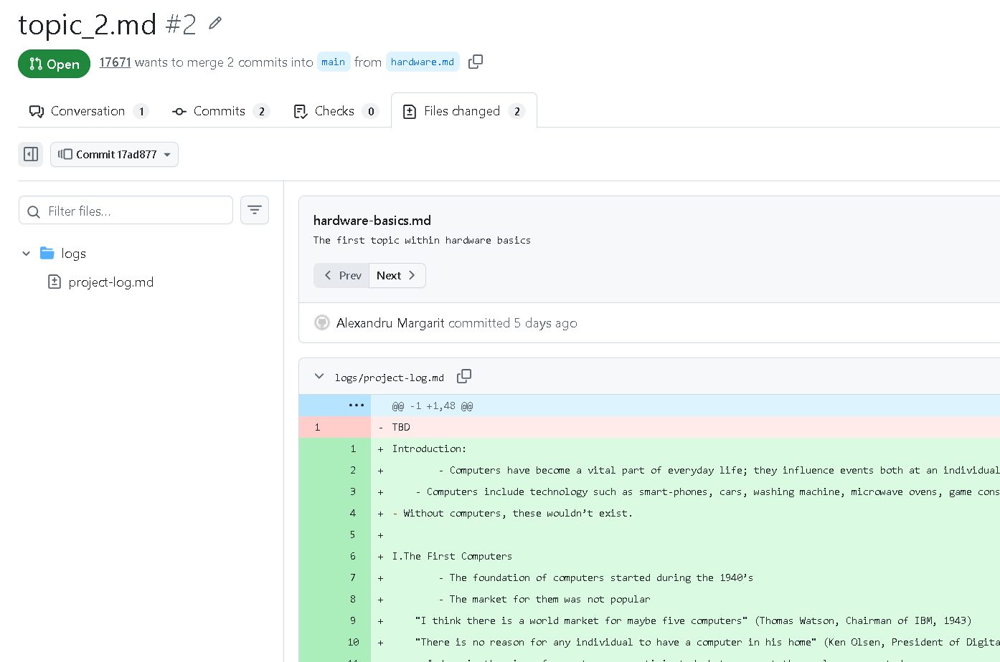

### October 25, 2026

- **When:** October 25, 2026
- **Who:** MARGARIT SERBAN ALEXANDRU (Content Lead)
- **What was done:** Created a draft for the third topic, "Motherboards, Memory and Processors," in `/content/chapter-3-motherboards-memory-processors.md`. Covered motherboard structure and components, expansion slots (ISA, PCI, AGP), ports (USB, SCSI, A-D, serial, parallel), power supply and VRMs, chipsets, and the six main types of buses.
- **What resulted:** Pushed the file to GitHub and opened a Pull Request for review.
- **What was learned:** A motherboard is a sandwich of non-conductive outer layers and a conductive inner layer, and its chipset determines whether an instruction or data is retrieved from main memory or cache. Expansion slots and ports link the motherboard to external devices (USB can provide power and notify the OS of status changes). The power supply steps down voltage and converts AC to DC, with VRMs supplying specific voltages. Bus width is measured in bits, and bus speed is measured in MHz.
- **What happens next:** Solgitt (Quality Lead) will review the file by October 27. Once approved, Hamid (Visual Lead) will begin creating diagrams for the motherboard sandwich structure, expansion slots, and bus types.
- **Evidence:** 
  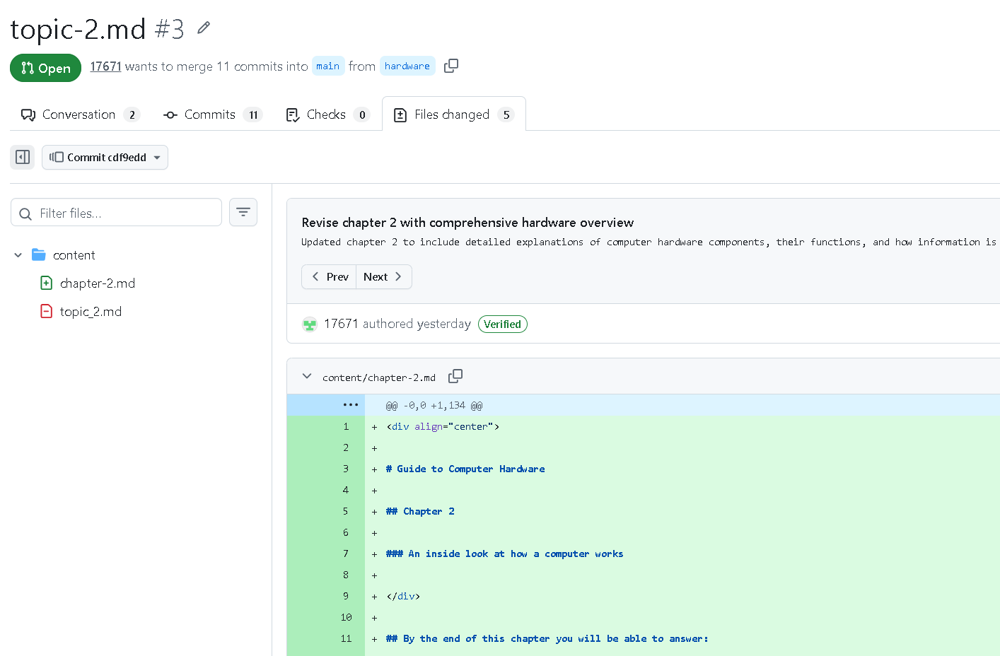

### October 26, 2026

- **When:** October 26, 2026
- **Who:** KHO EDUARD (CEO)
- **What was done:** Held an urgent meeting regarding resubmission. Created the meeting summary for October 26 (`logs/meetings/2026.10.26.md`). Fixed minor formatting mistakes in the previous meeting summary (`2026.10.19.md`).
- **What resulted:** Planned urgent task untill 29-th of Ocrober. Also, discussed follow-ups for the 30-th presentation.
- **What was learned:** None.
- **What happens next:** New draft of the topic 1 and 2.
- **Evidence:** 
  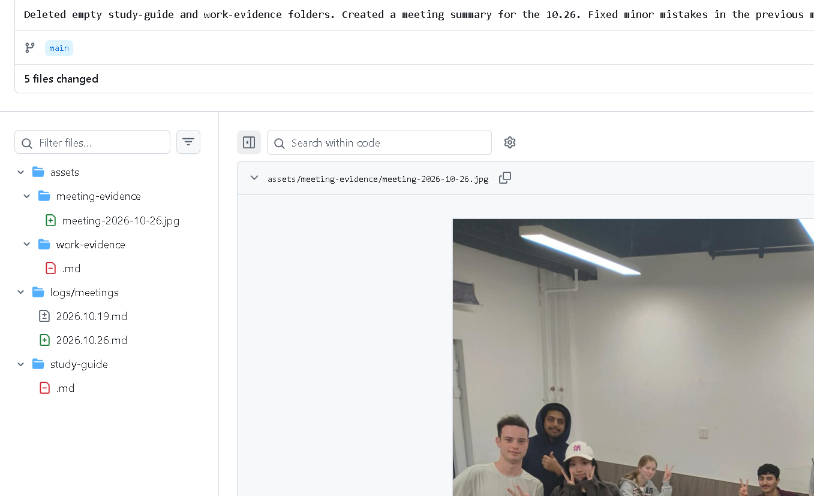