# Project Log

**Course:** Foundations of Computer Science & AI  
**Team:** PikaByte  
**Selected module:** Hardware, Networks & Behaviorist AI  
**Purpose:** This document is the team's chronological diary. It records progress and completed work. It serves as proof of our workflow and contributions for the project.
**Repository:** https://github.com/17671/Best-ever  

## Logging Rules

1. **Chronological & Specific:** Record work as it happens. Do not write a massive summary just before the deadline. Do not write entries for empty days. Be specific (e.g., "Drafted Topic 1 CPU analogy" is acceptable; "Worked on hardware" is not).
2. **Required Fields:** Every entry must include:
   - **When?** (Date)
   - **Who?** (Name and role)
   - **What was done?**
   - **What resulted?** (Outcome)
   - **What was learned?** (Insight or difficulty)
   - **What happens next?** (Next tasks and owners)
3. **Evidence Proximity:** Paste screenshots (commits, PRs, outputs).
4. **AI Use:** Document significant AI use in the entry with these subsections:
   - **Tool & Date:** (e.g., DeepSeek, Oct 20)
   - **Purpose:** What you were trying to solve.
   - **Interactions:** Screenshots of the prompt and output.
   - **Verification:** How you checked it (what you accepted/rejected).
5. **Personal Logs:** Personal reflections and individual AI use do **NOT** go here. They must be kept in your own private Word document and submitted separately.

## Log Entries

### October 16, 2026

- **When:** October 16, 2026
- **Who:** KHO EDUARD (CEO)
- **What was done:** Created the first `README.md` with the team roster and selected module.
- **What resulted:** Created the first Markdown file of the repo. Filled in the roster and chosen module.
- **What was learned:** Practised markdown syntax. Learned how to create files and commit changes in the repo.
- **What happens next:** Read all the instructions and Write a manual for the team with the basics of workflow.
- **Evidence:** 
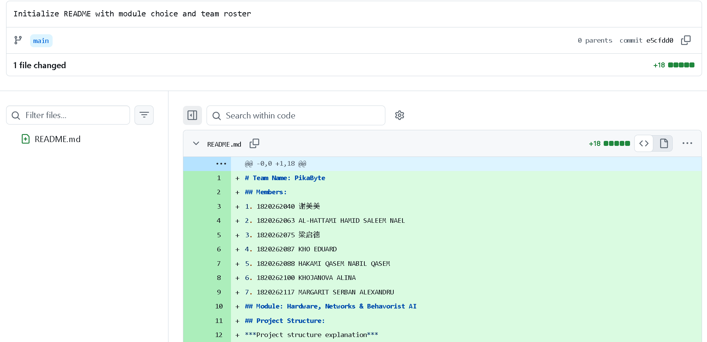
- **AI Use:** 
   - **Tool & Date:** DeepSeek, Oct 16
   - **Purpose:** Needed help with comprehending ppt0 and assignment descriptions. Also asked questions regarding GitHub fearures
   - **Interactions:** 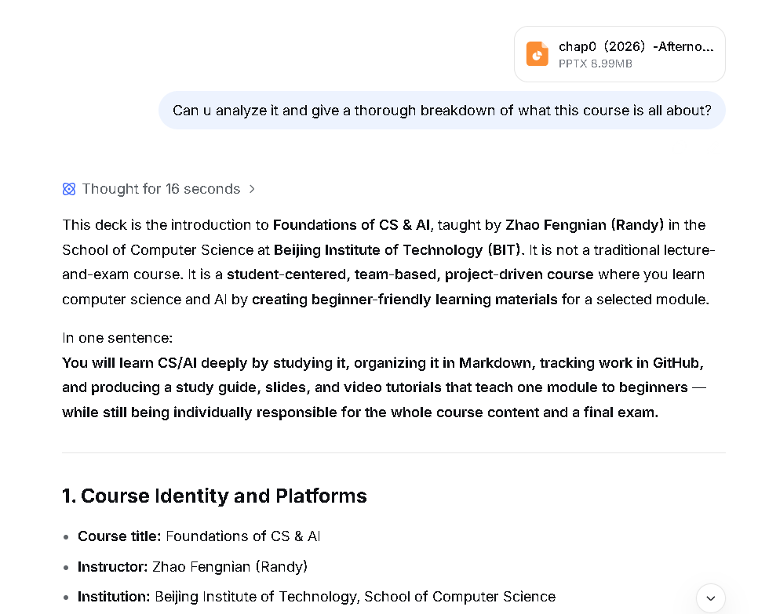
   - **Verification:** Checked the main poins in the assignment descriptions.

### October 17, 2026

- **When:** October 17, 2026
- **Who:** KHO EDUARD (CEO)
- **What was done:** Drafted the team manual (`manual.md`). Created the `assets` folder. Updated README.
- **What resulted:** The initial version of the Team Manual with roles and GitHub workflows. Created the assets folder.
- **What was learned:** Git does not see empty folders. I had to creaete a placeholder file.
- **What happens next:** Finish the manual by adding logging rules and AI usage. Refer to checklist
- **Evidence:** 
  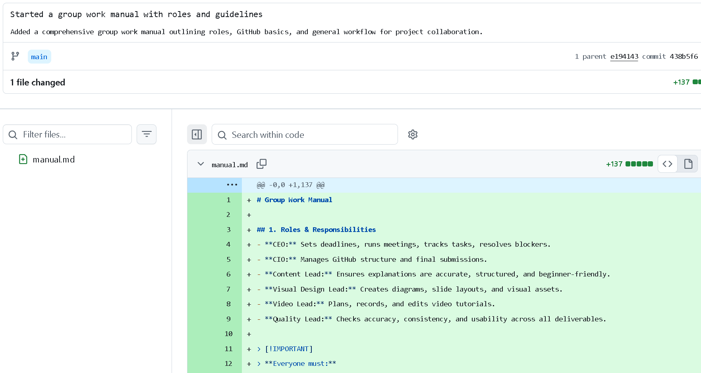
- **AI Use:** 
   - **Tool & Date:** DeepSeek, Oct 17
   - **Purpose:** Needed help with Markdown syntax.
   - **Interactions:** 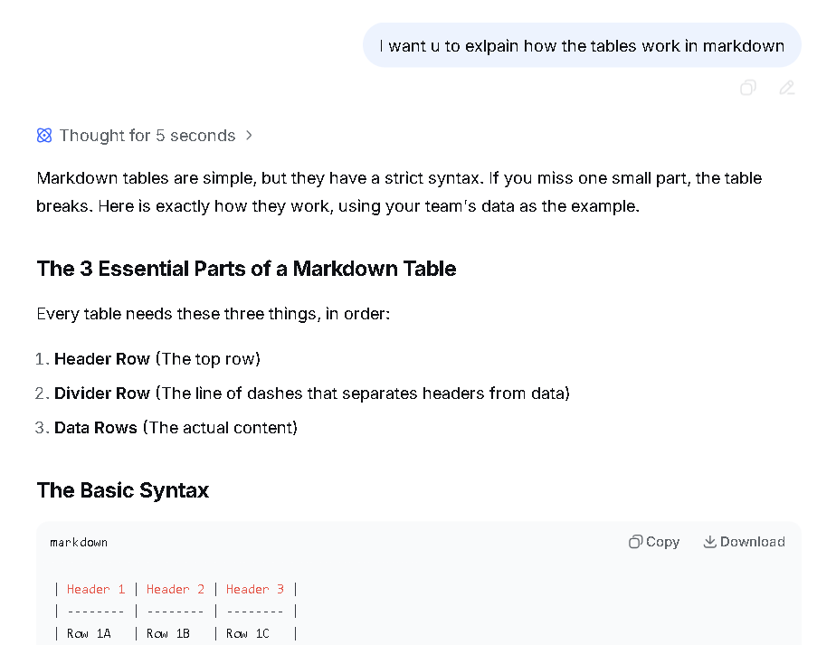
   - **Verification:** Tried making tables in the file.

### October 18, 2026

- **When:** October 18, 2026
- **Who:** KHO EDUARD (CEO)
- **What was done:** Added the initial folder structure, updated the mmanual.
- **What resulted:** The repository structure was set. Manual starts explaining VS Code workflow.
- **What was learned:** Started comprehending new VS Code workflow for a new manual.
- **What happens next:** Prepare for the first team meeting to explain VS Code and the new workflow.
- **Evidence:** 
  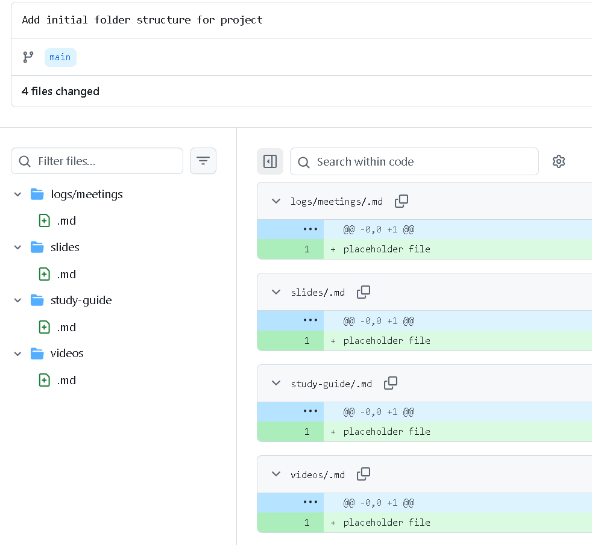
- **AI Use:** 
   - **Tool & Date:** DeepSeek, Oct 18
   - **Purpose:** Read the teacher guide to understand the VS Code workflow and figure out what to do first.
   - **Interactions:** 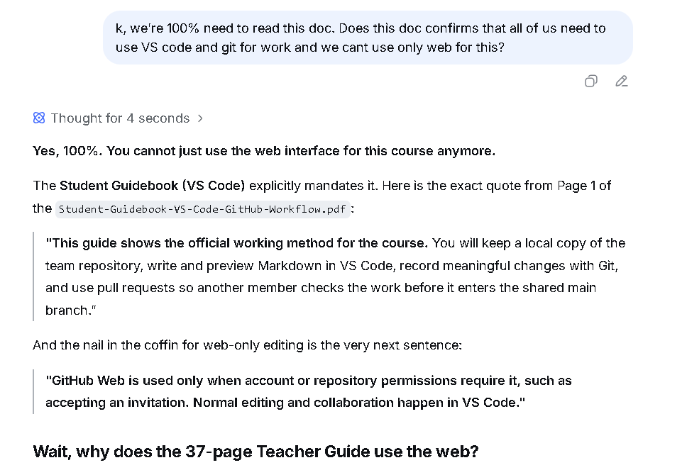
   - **Verification:** Cross-checked the AI's breakdown of the guide with the actual document.

### October 19, 2026

- **When:** October 19, 2026
- **Who:** KHO EDUARD (CEO), Solyn, Hamid, Qasem
- **What was done:** Hosted the first team meeting at 24HR Study Point. Explained the VS Code and GitHub branch workflow.
- **What resulted:** Attending members successfully cloned the repository and understood the basic branch workflow.
- **What was learned:** Explaining Git branches and pull requests takes longer than expected.
- **What happens next:** Create tasks.md, explain and start personal logs.
- **Evidence:** 
  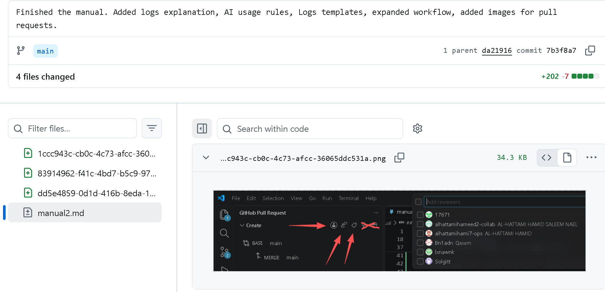

### October 20, 2026

- **When:** October 20, 2026
- **Who:** KHO EDUARD (CEO)
- **What was done:** Created `tasks.md` with the initial outline of Stage 1 tasks. Updated `README.md` with better structure. Created the first meeting log (`2026.10.19.md`). Updated `manual2.md` with image naming rules and relative path explanations. Reorganized the `/assets/` folder into subfolders (visuals, work-evidence, etc.). Fixed broken image links in the meeting log.
- **What resulted:** The repository was fully organized. All images rendered correctly, and the task list and templates were ready for the team.
- **What was learned:** Learned how to write relative paths.
- **What happens next:** Begin drafting the first topic (Computer Hardware Basics).
- **Evidence:** 
  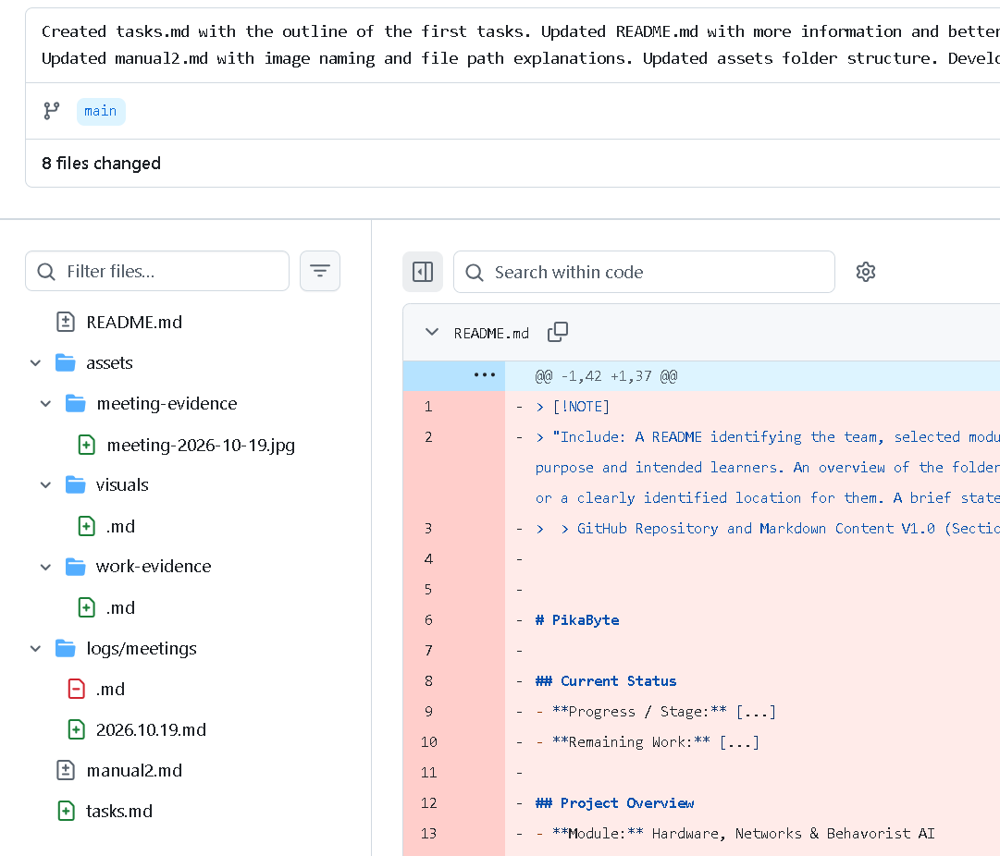
- **AI Use:** 
   - **Tool & Date:** DeepSeek, Oct 20
   - **Purpose:** Needed help debugging why images weren't rendering in the VS Code preview and organizing the asset folders to avoid naming redundancy.
   - **Verification:** Fixed the image path. Wrote the new folder structure in the README.

### October 22, 2026

- **When:** October 22, 2026
- **Who:** MARGARIT SERBAN ALEXANDRU (Content Lead)
- **What was done:** Created a draft for the second topic, "An Inside Look at How a Computer Works,". Covered information identification (bits, bytes, ASCII), external and internal components, CPU/memory functions, interrupt handling, bus types, and the step-by-step process of moving data.
- **What resulted:** Pushed the file to GitHub and opened a Pull Request for review.
- **What was learned:** Computers encode all information as binary (0s and 1s); a byte holds 8 bits and ASCII assigns numeric values to characters. I also learned how the CPU, ROM, RAM, and clock interact, and that interrupts are priority messages that override current processes. Throughput depends on architecture, clock cycles, bus size, and processing power.
- **What happens next:** Solgitt (Quality Lead) will review the file by October 24. Once approved.
- **Evidence:** 
  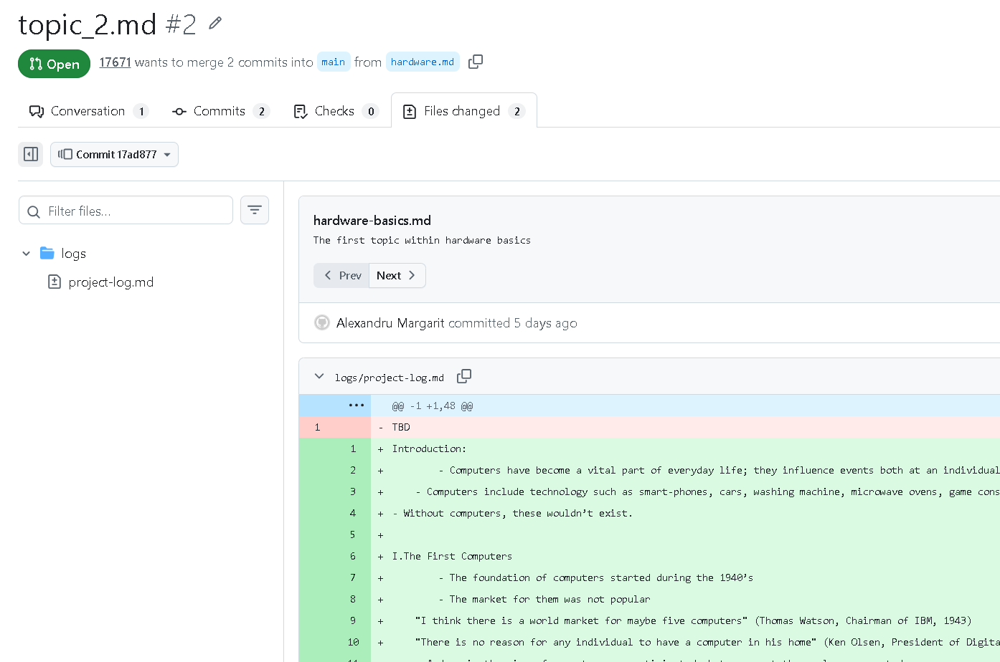

### October 25, 2026

- **When:** October 25, 2026
- **Who:** MARGARIT SERBAN ALEXANDRU (Content Lead)
- **What was done:** Created a draft for the third topic, "Motherboards, Memory and Processors," in `/content/chapter-3-motherboards-memory-processors.md`. Covered motherboard structure and components, expansion slots (ISA, PCI, AGP), ports (USB, SCSI, A-D, serial, parallel), power supply and VRMs, chipsets, and the six main types of buses.
- **What resulted:** Pushed the file to GitHub and opened a Pull Request for review.
- **What was learned:** A motherboard is a sandwich of non-conductive outer layers and a conductive inner layer, and its chipset determines whether an instruction or data is retrieved from main memory or cache. Expansion slots and ports link the motherboard to external devices (USB can provide power and notify the OS of status changes). The power supply steps down voltage and converts AC to DC, with VRMs supplying specific voltages. Bus width is measured in bits, and bus speed is measured in MHz.
- **What happens next:** Solgitt (Quality Lead) will review the file by October 27. Once approved, Hamid (Visual Lead) will begin creating diagrams for the motherboard sandwich structure, expansion slots, and bus types.
- **Evidence:** 
  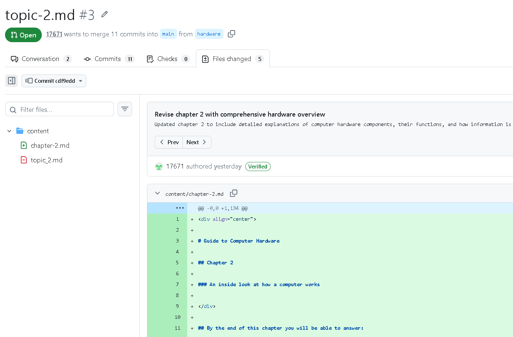

### October 26, 2026

- **When:** October 26, 2026
- **Who:** KHO EDUARD (CEO)
- **What was done:** Held an urgent meeting regarding resubmission. Created the meeting summary for October 26 (`logs/meetings/2026.10.26.md`). Fixed minor formatting mistakes in the previous meeting summary (`2026.10.19.md`).
- **What resulted:** Planned urgent task untill 29-th of Ocrober. Also, discussed follow-ups for the 30-th presentation.
- **What was learned:** None.
- **What happens next:** New draft of the topic 1 and 2.
- **Evidence:** 
  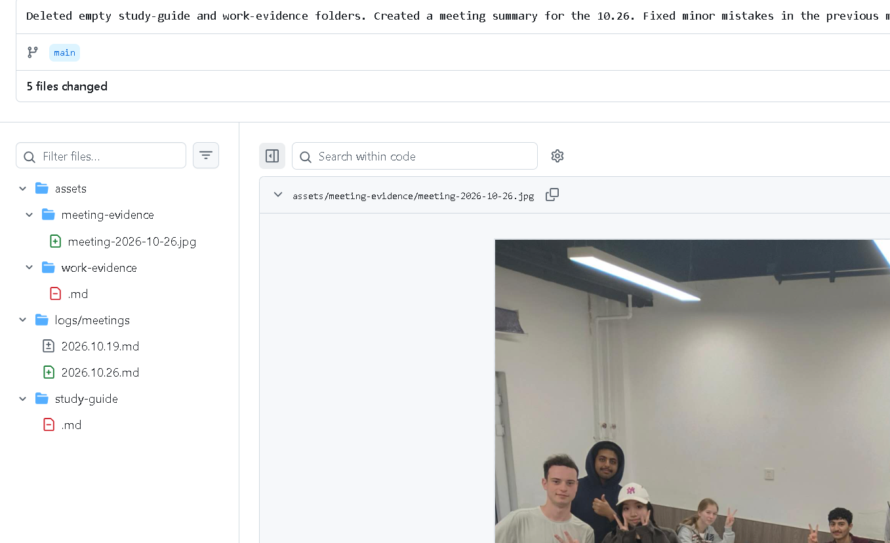

--- 

### Stage 2

---

### October 26, 2026

- **When:** October 26, 2026
- **Who:** KHO EDUARD (CEO), AL-HATTAMI HAMID (Visual Design Lead), 梁启德 (Quality Lead)
- **What was done:** Held an urgent team meeting at 24HR Study Point. Discussed the Stage 1 resubmission requirements, clarified the `/content/` vs `/study-guide/` folder misunderstanding, and planned the Live Status Report.
- **What resulted:** The team aligned on urgent tasks, established a clear timeline for resubmission, and outlined the talking points for the status report.
- **What was learned:** It was challenging to guide the conversation while incorporating everyone's strategic vision, but clear communication resolved the folder misunderstanding.
- **What happens next:** Begin drafting the resubmission files and prepare the presentation script.

### October 28, 2026

- **When:** October 28, 2026
- **Who:** KHO EDUARD (CEO), 梁启德 (Quality Lead)
- **What was done:** Eduard assembled the final ZIP packages, compiled `Content_V1.pdf`, wrote the Resubmission Report, and submitted the late Stage 1 resubmissions to Lexue. Solyn reviewed and approved Chapters 1-3 using Doubao AI to cross-check sources.
- **What resulted:** The Stage 1 resubmission was successfully uploaded. Chapters 1-3 were approved and merged into GitHub.
- **What was learned:** Compiling files and fixing repository structures takes a massive amount of time. AI verification requires strict oversight to avoid blindly accepting flawed responses.
- **What happens next:** Pivot to the new 8-chapter Stage 2 module outline and begin content creation.
- **AI Use:** 
   - **Tool & Date:** Doubao, Oct 28.
   - **Purpose:** To make the verification of the source and the written text faster.
   - **Interactions:** *Prompt: "check the info on this chapter with the next chapter in the book related to this. show proof of the validity and send it here. do not conclude on your own and confirm that the text is cohesive. Remove hallucinations and all sycophancy"*
   - **Verification:** Read through the AI's proof, but acknowledged that taking the AI's response at face value is a mistake.

### October 30, 2026

- **When:** October 30, 2026
- **Who:** HAKAMI QASEM (CIO), AL-HATTAMI HAMID (Visual Design Lead)
- **What was done:** Qasem researched and drafted the initial "AI Basics" topic outline. Hamid began writing the assigned chapter using *Simply Artificial Intelligence* as a primary source.
- **What resulted:** A foundational outline for the AI section was created, and the initial chapter draft was structured.
- **What was learned:** Finding a reliable source before starting to write helps organize thoughts and ensures content accuracy for beginners.
- **What happens next:** Turn the chapter material into finalized Markdown files.
- **AI Use:** 
   - **Tool & Date:** DeepSeek, Oct 30.
   - **Purpose:** To skim the *Simply Artificial Intelligence* book to highlight potentially useful chapters for the assigned topic.
   - **Interactions:** *Prompt: "Based on this table of contents, which chapters are most relevant for a basic 'Introduction to AI' topic?"*
   - **Verification:** Manually reviewed the AI's suggestions by reading the first few pages of each recommended chapter to confirm relevance.

### October 31, 2026

- **When:** October 31, 2026
- **Who:** KHOJANOVA ALINA (Visual Design Lead)
- **What was done:** Prepared the course material for the module by generating Chapter 1, 2, and 3 outlines, analogies for network topologies, and a draft slide deck.
- **What resulted:** Four distinct planning/summary pages were saved to establish the core structure for the chapters and visuals.
- **What was learned:** AI is excellent at generating analogies for complex topics (like network routers), but it often skips prerequisite definitions which must be added manually.
- **What happens next:** Refine the outlines and begin building the actual study files.

### November 1, 2026

- **When:** November 1, 2026
- **Who:** KHO EDUARD (CEO)
- **What was done:** Created personalized Stage 2 task and explanation files for every individual member containing specific instructions and rubric requirements. Reorganized the `/assets/` folder structure.
- **What resulted:** Every member had a personalized guide, removing ambiguity about what they needed to do for Stage 2.
- **What was learned:** Breaking down a massive assignment into personalized daily tasks is the only way to prevent the team from getting overwhelmed.
- **What happens next:** Monitor progress and begin drafting the content and visual deliverables.

### November 2, 2026

- **When:** November 2, 2026
- **Who:** KHO EDUARD (CEO), 谢美美 (Video Lead), 梁启德 (Quality Lead)
- **What was done:** Eduard created the official Lexue Learning Center thread. Luna watched the media design/content design videos on Lexue and reviewed previous years' videos. Solyn established a new QA workflow using a strict DeepSeek checklist (checks, warnings, X's) to review Markdown chapters.
- **What resulted:** The Lexue thread was published. Luna created a multimedia design rules checklist. Solyn flagged missing glossary items in Topic 1.1 to Alex.
- **What was learned:** Setting up the thread early allows classmates to find materials quickly. Using a structured AI checklist makes QA checks significantly faster.
- **What happens next:** Continue drafting the Markdown content and begin assembling the Study Guide base.
- **AI Use:** 
   - **Tool & Date:** DeepSeek, Nov 2.
   - **Purpose:** To create a chat with a set method to flag parts that did not fit the criteria according to a strict rubric.
   - **Verification:** Checked that the rubric set matches the checklist document sent to the AI.

### November 3, 2026

- **When:** November 3, 2026
- **Who:** HAKAMI QASEM (CIO), AL-HATTAMI HAMID (Visual Design Lead), KHO EDUARD (CEO), 梁启德 (Quality Lead)
- **What was done:** Qasem and Hamid wrote the Markdown content for Chapters 3.1 and 3.3, submitting PRs for review. Eduard reviewed Hamid's Study Guide sample and rejected it for being pictures instead of an editable `.docx`. Solyn continued checking Chapter 1 and started checking Chapter 3 using the AI workflow.
- **What resulted:** Markdown PRs for Chapters 3.1 and 3.3 were opened. Hamid understood the requirement for an editable Word document.
- **What was learned:** We must explicitly verify file formats (like `.docx`) before the packaging phase. Visual outputs are not enough if we need to edit the layout later.
- **What happens next:** Step in to build the Study Guide Word template and finalize the Markdown files.
- **AI Use:** 
   - **Tool & Date:** DeepSeek, Nov 3.
   - **Purpose:** To perform the QA checking.
   - **Interactions:** Asked the AI to recall its checking method and perform the process for every chapter.
   - **Verification:** Manually verified the AI's flags.

### November 4, 2026

- **When:** November 4, 2026
- **Who:** KHO EDUARD (CEO)
- **What was done:** Built the base template for the Study Guide by formatting Chapter 1 entirely in a Microsoft Word `.docx` file. Set up the Table of Contents, heading styles, and styled Activity Boxes. Created and published the official Lexue Learning Center thread.
- **What resulted:** A fully functional, editable Word template was uploaded to the repository for the team to use. The Lexue thread was live with the module introduction and resource directory.
- **What was learned:** Stepping in to do the heavy lifting is sometimes necessary when a teammate is blocked. Setting up the Lexue thread early forces the team to clearly articulate the project's scope.
- **What happens next:** Hamid will use the template to format the remaining chapters; Alina will begin designing the Canva slides.

### November 5, 2026

- **When:** November 5, 2026
- **Who:** HAKAMI QASEM (CIO), AL-HATTAMI HAMID (Visual Design Lead)
- **What was done:** Collaborated to draft the Test Bank questions (True/False, Multiple Choice, Open-Ended) in Markdown format for the completed chapters.
- **What resulted:** A raw pool of questions was created, ensuring the Open-Ended questions required paragraph-length reasoning.
- **What was learned:** Creating plausible Multiple Choice distractors is the most time-consuming part of drafting a Test Bank.
- **What happens next:** Compile all test banks into one document.

### November 5, 2026

- **When:** November 5, 2026
- **Who:** KHOJANOVA ALINA (Visual Design Lead)
- **What was done:** Created the Pokémon-themed slide decks for Chapter 1 (Pikachu) and Chapter 2 (Rotom). Wrote the slide text, designed layouts, created interactive practice activities, and wrote the Presenter Notes.
- **What resulted:** Two complete slide decks were drafted and prepared for export.
- **What was learned:** Creating interactive activities requires careful phrasing so beginners can follow them without getting stuck.
- **What happens next:** Export to PowerPoint and fix formatting issues.

### November 5, 2026

- **When:** November 5, 2026
- **Who:** 梁启德 (Quality Lead)
- **What was done:** Finished reviewing all Markdown PRs and merged them. Reviewed the finished Chapter 1 PPT and the Video Script using a Text-to-Speech bot (CleverHumanizer.ai) to check audio-visual sync.
- **What resulted:** All Markdowns were finalized, and the visual deliverables were approved.
- **What was learned:** Using text-to-speech tools makes checking video scripts and slide pacing much faster and less tedious.
- **What happens next:** Wait for the final video export and prepare for the Stage 2 submission package.
- **AI Use:** 
   - **Tool & Date:** DeepSeek & CleverHumanizer.ai (Text-to-Speech), Nov 5.
   - **Purpose:** To review the video script and match it with the content on the slides much faster and more efficiently.
   - **Verification:** Listened to the TTS audio while looking at the PPT slides to ensure they were synchronized and accurate.

### November 5, 2026

- **When:** November 5, 2026
- **Who:** KHO EDUARD (CEO)
- **What was done:** Updated `tasks.md` on GitHub with the Stage 2 and Live Mini Lecture tasks. Drafted the full 8-minute outline and script for the HW7 Mini Lecture ("Why are GPUs useful for AI?").
- **What resulted:** The team had a finalized roadmap, and the first draft of the Mini Lecture was ready.
- **What was learned:** Drafting an 8-minute live lecture requires careful pacing to ensure the audience can follow the math activity.
- **What happens next:** Discuss the topic with the professor and sign up.

### November 6, 2026

- **When:** November 6, 2026
- **Who:** KHO EDUARD (CEO)
- **What was done:** Discussed the HW7 topic with the professor for approval. Officially signed the team up on the `Mini-Lecture-Topic-Signup.xlsx` Excel sheet. Prepared every single document for the Stage 2 submission.
- **What resulted:** The HW7 topic was officially secured. All Stage 2 files were packaged and organized into the final ZIP folders.
- **What was learned:** Consulting the professor ensures our scope matches his expectations. The packaging phase always takes longer than expected and requires meticulous checking.
- **What happens next:** Upload Stage 2 to Lexue.

### November 6, 2026

- **When:** November 6, 2026
- **Who:** HAKAMI QASEM (CIO)
- **What was done:** Consolidated the individual chapter test banks into one combined `PikaByte_TestBank_V1.docx` document. Created a submission checklist to ensure nothing was missed, and drafted the chapter glossaries.
- **What resulted:** The combined Test Bank was completed, the checklist was handed to the CEO, and the glossaries were drafted.
- **What was learned:** Organizing the combined document highlighted the need for consistent formatting across all chapters.
- **What happens next:** Combine all glossaries into a Mega Glossary.

### November 6, 2026

- **When:** November 6, 2026
- **Who:** AL-HATTAMI HAMID (Visual Design Lead)
- **What was done:** Formatted the Hardware and Networks chapters in the Study Guide Word document, adding styled Activity Boxes and diagrams. Pasted the remaining AI chapters as raw text due to time constraints.
- **What resulted:** The Study Guide `.docx` was fully assembled (though only partially formatted). Chapter glossaries were drafted.
- **What was learned:** Formatting a large Word document takes significantly longer than expected, necessitating the decision to paste the later chapters to meet the deadline.
- **What happens next:** Finalize the Mega Glossary.

### November 6, 2026

- **When:** November 6, 2026
- **Who:** KHOJANOVA ALINA (Visual Design Lead)
- **What was done:** Corrected formatting issues in the exported PowerPoint files. Noticed that text boxes and other elements had shifted during the Canva export process and manually realigned them in PowerPoint.
- **What resulted:** Both PPTX files were fully aligned and visually accurate.
- **What was learned:** Canva and PowerPoint do not translate perfectly; exports must be immediately checked and manually fixed.
- **What happens next:** Upload the final `.pptx` files to GitHub.

### November 6, 2026

- **When:** November 6, 2026
- **Who:** 谢美美 (Video Lead)
- **What was done:** Produced the final video tutorial. Edited the video using the Canva PPT slides as visuals and wrote the final narration script to match the slides exactly. 
- **What resulted:** Completed the video editing process and finalized the script. The final MP4 was exported and verified to be under the 250 MB limit.
- **What was learned:** Writing the script based on the finished slides ensures the narration perfectly matches what the audience sees on screen.
- **What happens next:** Final review of audio quality and pacing.

### November 7, 2026

- **When:** November 7, 2026
- **Who:** HAKAMI QASEM (CIO), AL-HATTAMI HAMID (Visual Design Lead)
- **What was done:** Combined all individual chapter glossaries from all teammates into one comprehensive document. Alphabetized all terms to create a single, easy-to-use Mega Glossary.
- **What resulted:** A final, alphabetized A-Z Mega Glossary containing key terms from all chapters was created.
- **What was learned:** Combining the glossaries revealed inconsistencies in how certain terms were defined or capitalized across different chapters, which had to be standardized manually.
- **What happens next:** Hand the Mega Glossary to the CEO for final packaging.
- **AI Use:** 
   - **Tool & Date:** DeepSeek, Nov 7.
   - **Purpose:** To automate the process of combining and reorganizing the glossaries.
   - **Interactions:** *Prompt: "Combine these glossaries into a single list and sort them alphabetically."*
   - **Verification:** Proofread the final compiled list against the original sources to ensure no terms were lost or definitions altered.

### November 7, 2026

- **When:** November 7, 2026
- **Who:** KHO EDUARD (CEO)
- **What was done:** Submitted all Stage 2 deliverables (Study Guide, Test Bank, PPT Slides, Video Tutorials) to Lexue before the deadline.
- **What resulted:** The Stage 2 deadline was met successfully and all files were uploaded to the designated assignment area.
- **What was learned:** The final submission process requires constant vigilance and clear communication across the whole team to ensure no files are missed.
- **What happens next:** Shift focus entirely to rehearsing the Live Mini Lecture (HW7).
