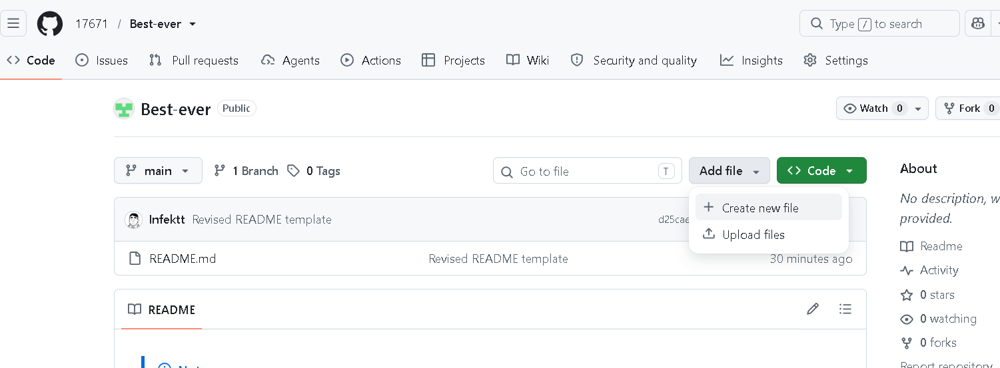
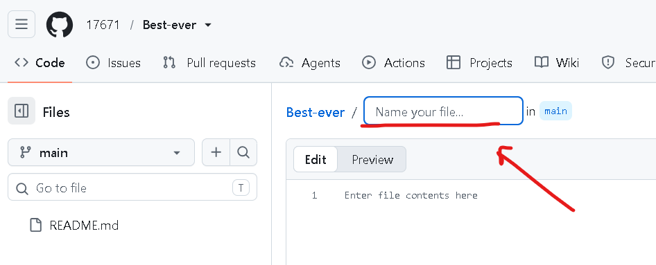
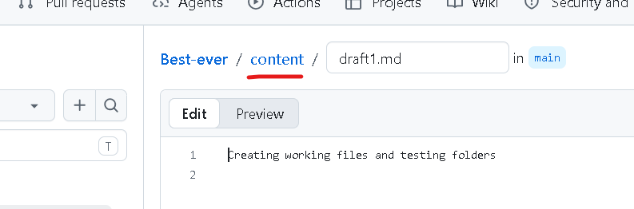
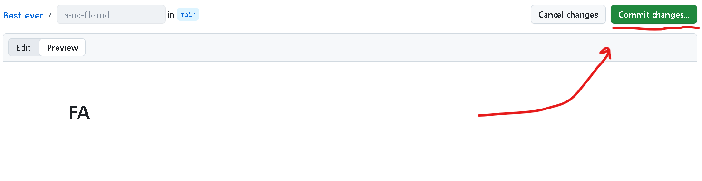
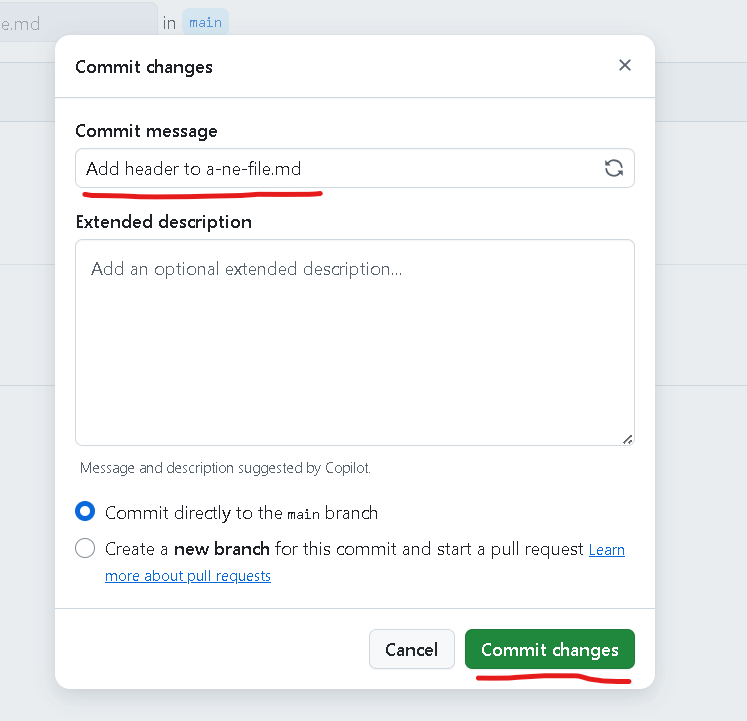
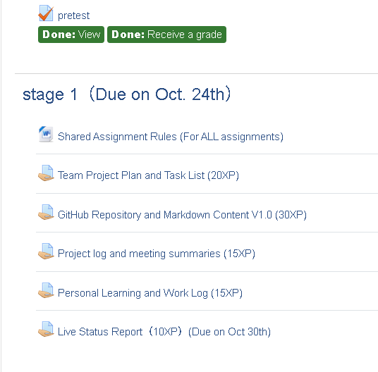
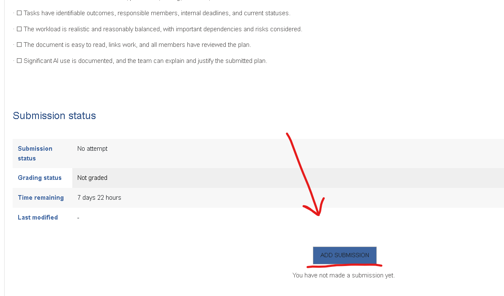

# Group Work Manual

## 1. GitHub Basics:

### Creating a New File
   

---

### Naming Files:

Once created, it should be named. Here are some general rules we will use for naming files in this repository:

1. **Use a proper file extension.**
For Markdown files u should use `.md`.
3. **Use lowercase and hyphens.**
   E.g., `a-new-file.md`.
3. **Be descriptive.**
   We'll discuss proper templates later.

---

### Folders:

GitHub's web interface doesn't have a "New Folder" button. Instead, you create a folder by including it in a file path when you create or upload a file.  
I.e., to create a folder u should simply modify the file's name in a specific way. 

Click Add file → Create new file.

In the filename box, type: [folder name] + "/" + [file name] + [extension]

Example: `aaaaaa/a-new-file.md`

This creates a folder called "aaaaaa" and a file called "a-new-file.md" inside it.

After typing "/", this is what it will look like:

---

### Submitting Files (Commiting Changes):

Once finished, click "**Commit Changes**".

Afterwards, u can either fill in the "Commit Message" and "Extended Description" yourself or wait for an AI to do it for u.
> [!NOTE]
> All the excerpts from the assignment descriptions regarding "Commit Message":
> > - Shared Assignment Rules (Section 3): “Make meaningful commits as work progresses, with messages describing the changes.”
> > - GitHub Repository assignment (Section E): “Readable commit history showing authors, dates, and meaningful descriptions of changes.”
> > - Evidence requirement: “Examples of actual changes: Selected change views showing what was added, corrected, or improved—not just a list of commit messages.”
> 
> Which are not clear enough. So, we should either decide smt ourselves or ask the professor.

---

### Issues:

#### Purpose:

GitHub Issues are like **sticky notes** for the project. Instead of managing tasks in a separate chat or spreadsheet, you create an Issue for every task, bug, or idea directly inside the repository.
> I.e., opening an issues is like marking a specific problem in a separate document to tracking its progress separately.

> [!IMPORTANT]
> For this project issues will be predominantly opened by Quality Lead / Tester (QA).
>
> The most of the roles just need to be able to properly commit changes to the issues.

#### How to create:

---

---

> For this project we will not use the milestone category.

> [!IMPORTANT]
> 
> For this project you will receive issues with these labels only, and this is what they mean.

---

#### Example of usage:

##### Step 1: The Quality Lead Opens the Issue
The Quality Lead reviews a draft (e.g. `/content/hardware.md`) and finds a problem. They go to the Issues tab and click New Issue.

##### Step 2: The Member Does the Work
They get a notification. They go to the actual draft `hardware.md`, draw a diagram, upload it to `/assets/`, link it in the Markdown, and commit the changes.

##### Step 3: The Member Replies to the Issue
They go back to the Issue on GitHub and types a comment at the bottom (e.g. "I've added the diagram and linked it in the file.)

##### Step 4: The Quality Lead Verifies (The Important Part)
The Quality Lead does not just take their word for it. He clicks on the commit link, reads the updated `hardware.md`, and checks that the image actually displays correctly.

##### Step 5: The Quality Lead Closes the Issue
If everything is fixed correctly, the Quality Lead types a final comment ("Looks great. Verified."), and click the "Close issue" button.

Else, the Quality Lead would leave another comment (e.g. "The image is broken, please fix it") and leave the Issue open.

## 2. General workflow (Where, What, How):

### Where:

We work in two places:

#### 1. Lexue:
- assignment descriptions,
- deadlines,
- final submissions.

---

#### 2. GitHub:
- all working files,
- drafts,
- logs + evidence.

You do not submit GitHub links as your assignment. You submit the actual files (Word, PDF, ZIP, etc.) to Lexue. 

---

### What:

The group’s goal is to create a set of beginner-friendly learning materials for our selected module. This consists of three major deliverables, all built from a shared Markdown foundation.
I.e. we store everything in the GitHub. 

> [!IMPORTANT]
> - **Study guide**
>   - Main purpose: Help a beginner study independently.
>   - Essential content: Learning objectives, explanations, examples, activities, exercises, and references.
>   - The proposed structure and how learners will study, practise, and check their understanding.
> - **PPT slides**
>   - Main purpose: Support a clear visual explanation.
>   - Essential content: A logical sequence, key ideas, diagrams, and worked examples.
>   - How you will explain important ideas visually, including possible diagrams or worked examples.
> - **Video tutorials**
>   - Main purpose: Guide learners through explanations and demonstrations.
>   - Essential content: Clear narration, readable visuals, appropriate pacing, and demonstrations where useful.
>   - The proposed tutorial topics and which concepts or processes would benefit from narration and demonstration.
> 
> > From the Chapter 0 presentation (Slide 21) and Team Project Plan and Task List (20XP), Section C

All three must be accurate, beginner-friendly, coherent, and consistent with each other. We also prepare a live mini lecture on one important topic from our module.

To gather information, we use:

- **Lexue → "Learning materials"**
- **Previous years works** (the relatable previous years material is stored in the Google Drive folder (check the WeChat group)) 
- Online courses such as CS50,
- **Wikipedia**,
- learning sites such as Kaggle,
- **ChatGPT**,
- YouTube,
- Fellow students.
- Teacher.

### How:

#### Role responsibilities:

#### 1. CEO
- Responsible for the overall vision and goals of the project.
- Creates and manages the GitHub repository and folder structure.
- Assigns tasks through `master-task-list.md`, tracking statuses (`To Do` → `In Progress` → `Done`).
- Sets deadlines properly to ensure the final documents are submitted in Lexue on time.
- Acts as the main communicator with the professor.
- Ensures all members consistently update the project log, their personal logs, and AI-use records.
- Writes meeting notes and summaries in `/logs/meetings/`.

#### 2. Repository & Submission Lead (CIO)
- Manages team documentation and file organization in GitHub (ensuring `/content/` and `/assets/` are clean).
- Collects all final deliverables (ZIPs, Word/PDFs, Logs) for compilation.
- Handles submissions exclusively on Lexue, ensuring all files are named correctly and sent on time.
- Tracks deadlines, updates, and notifications on Lexue to prevent delays.
- Cross-checks GitHub progress against the `master-task-list.md` to ensure nothing is missing before submission.

#### 3. Content Lead / Writer
- Drafts and organizes reports and learning content.
- Writes the shared learning material in `/content/` as Markdown (`.md`) files.
- Proofreads and edits deliverables.
- Hands over finalized written materials in `/content/` to the Visual and Video leads so they can build the deliverables.
- Supports the Quality Lead by refining written materials flagged for improvement.
- Updates `master-task-list.md` changing the tasks status to either  "In progress" or "Waiting for review".

#### 4. Visual Design Lead
- Designs visual elements for slides, reports, and the study guide.
- Produces graphics, charts, diagrams, and flowcharts, uploading them to `/assets/`.
- Enhances presentations with animations, layouts, and visual consistency.
- Collaborates with the Content Lead to transform Markdown text from `/content/` into visually appealing slides in `/slides/`.
- Updates `master-task-list.md` changing the tasks status to either  "In progress" or "Waiting for review".

#### 5. Video Lead
- Creates and edits video tutorials to explain the module.
- Writes video scripts based on the shared Markdown in `/content/`.
- Records narration and screen demonstrations, ensuring clear pacing and readable visuals.
- Collaborates with the Visual Lead for graphics and the Content Lead for script accuracy.
- Updates `master-task-list.md` changing the tasks status to either  "In progress" or "Waiting for review".

#### 6. Quality Lead / Tester (QA)
- Monitors the `master-task-list.md` for tasks marked with "Waiting for review".
  - Marks tasks with "Done" if they pass the review
  - Either opens an issue or notifies the member if the work fails the review
- Reviews the final quality of each member's work (reports, Markdown content, slides, videos).
  - Checks deliverables for mistakes, missing content, or lack of clarity.
  - Ensures outputs meet the requirements set by the CEO and the course rubric.
- Monitors the `/logs/` folder:
  - Checks the credibility of log entries, verifying that attached evidence (screenshots, commits) actually supports the claims made.
  - Checks that commit messages, attached screenshots, and personal logs actually match the real work done. If a commit claims "finished slides" but the file is empty, they flag it by opening an issue or just notifying the team via wechat.
- Acts as the last checkpoint before the CIO submits to Lexue.

> [!IMPORTANT]
> **Everyone must:**
> - Study the module,
> - Contribute substantive work,
> - Understand the core content,
> - Be able to explain and prove their own contributions,
> - Learn the wider course content outside the team’s module.
