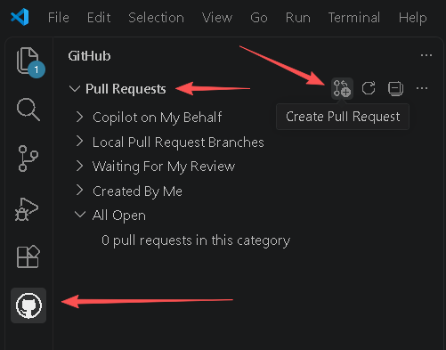
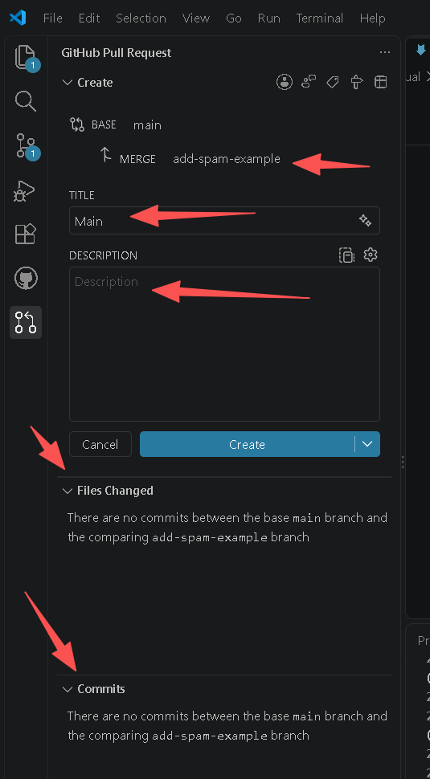
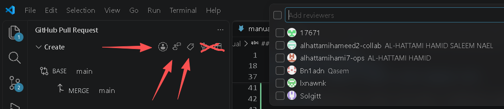
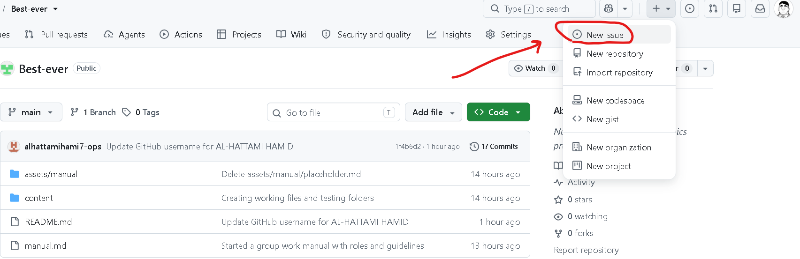
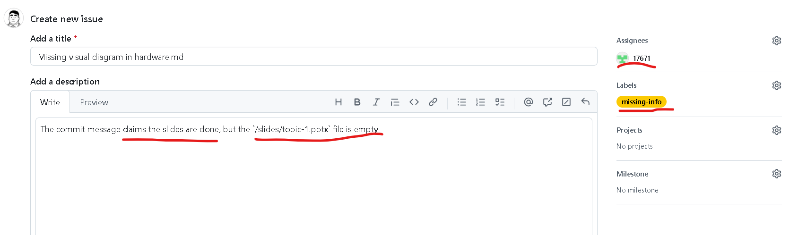
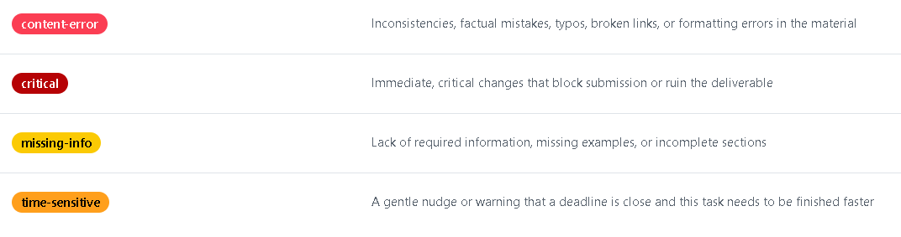

# Group Work Manual

> [!IMPORTANT]
> **The Workflow Has Changed.** We are no longer editing files on the GitHub website. We use **VS Code** and **Git** for all normal work. Read this manual carefully. If you are confused, ask @Infektt.

## 1. Setup
Every team member must do this on their own laptop:
1. **Download Git:** Install from `git-scm.com`.
2. **Download VS Code:** Install from `code.visualstudio.com`.
3. **Install Extension:** Open VS Code, go to Extensions (`Ctrl+Shift+X`), search for **GitHub Pull Requests** (by GitHub), and install it.
4. **Configure Git:** Open the Terminal in VS Code (`Ctrl+~`) and enter:
   `git config --global user.name "Your Name"`
   `git config --global user.email "your-noreply-email@users.noreply.github.com"`
5. **Clone the Repo:** Open VS Code, press `Ctrl+Shift+P`, type `Git: Clone`, paste our repository URL, and click **Open** when finished.

---

## 2. The Daily Workflow
**Never work directly on `main`.**

### Step 1: Pull the Latest Work
Click the branch name in the bottom left corner of VS Code (it probably says `main`). Click **Sync Changes** (or Pull) to download your teammates' latest work.

### Step 2: Create a Branch
Click `main` in the bottom left again, select **Create new branch**, and name it after your task (e.g., `add-spam-example`, `fix-logs`). 
- **Rule:** One task = one branch. Use lowercase and hyphens. Do not mix unrelated tasks.

### Step 3: Work & Commit
Write your Markdown, add images, and save (`Ctrl+S`). 
1. Go to the **Source Control** tab (left sidebar).
2. Click the `+` next to your changed files to stage them.
3. Type a clear commit message (e.g., "Draft spam filter explanation") and click **Commit**.

### Step 4: Push & Create a Pull Request (PR)
Click **Publish Branch** (or Push). Then:
1. Click the **GitHub Pull Requests** icon on the left.
2. Click **Create Pull Request**.

3. Add a title and description, assignee (yourself), reviewers (commonly Quality Lead, but some documents should add content lead as well), label (which are discussed in ***6. How to use GitHub Issues (Web Interface)***) and request a teammate to review it. 

### Step 5: Review & Merge
When a teammate approves your PR, click **Merge Pull Request**. 
**Important:** Once merged, click **Delete Branch**. The work is safely saved in `main`, and this cleans up the temporary workspace.

---

## 3. Repository Map & File Naming

### Where does everything go?
When you look at the Explorer tab (top-left icon in VS Code), you will see this structure. You must put your files in the correct folders:
* **`/content/`** — All shared learning material goes here as `.md` files (e.g., `hardware-basics.md`).
* **`/assets/`** — All images, diagrams, and screenshots (e.g., `cpu-diagram.png`).
* **`/logs/`** — Team tracking. Contains `project-log.md` and the `/meetings/` folder.
* **`/study-guide/`** — Drafts and final versions of the Study Guide.
* **`/slides/`** — Drafts and final versions of the PPT.
* **`/videos/`** — Scripts and final files for the video.

### File Naming Rules
If you name a file `Draft 1 final FINAL.md`, the team will hate you. Follow these rules:
1.  **Always use lowercase and hyphens.** No spaces, no capital letters (e.g., `neural-networks.md`, NOT `Neural Networks.md`).
2.  **Be descriptive.** A file named `notes.md` is useless. `symbolic-ai-notes.md` is perfect.
3.  **Always include the extension.** `.md` for text, `.png`/`.jpg` for images.

### Naming and Linking Images

**1. Where do images go?**
All images, diagrams, and screenshots must go inside the `/assets/` folder. To keep things organized, we use four specific subfolders:
- `/assets/visuals/` — Diagrams and charts for the Study Guide and Slides.
- `/assets/manual-images/` — Screenshots used in this manual.
- `/assets/work-evidence/` — Screenshots of GitHub PRs, commits, and AI chats.
- `/assets/meeting-evidence/` — Photos of the team working together.

**2. How to name image files:**
Just like Markdown files, image names must be descriptive. Follow these rules:
- **Always use lowercase and hyphens.** (e.g., `cpu-architecture.png`, NOT `CPU Architecture.PNG`).
- **Be descriptive.** Name it based on what the image actually shows. 
    - Bad: `image1.png`, `screenshot.jpg`, `photo.png`
    - Good: `fetch-decode-diagram.png`, `pr-4-merged.png`, `meeting-2026-10-19.jpg`
- **For evidence, start with the date.** This keeps them sorted chronologically. Format: `YYYY-MM-DD-topic.jpg`.
- **Always include the correct extension.** (`.png` for diagrams, `.jpg` for photos).

**3. How to link images in Markdown (Relative Paths):**
When you display an image in a Markdown file, you must use a **relative path**. This tells VS Code exactly how to find the image from the file you are currently editing. 

- **Root files** (like `README.md`): ``
- **One folder deep** (like `content/information.md`): ``
- **Two folders deep** (like `logs/meetings/2026-10-19.md`): ``

**Why the `../` works:**
- `../` means "go up one folder."
- `../../` means "go up two folders."

**The Ultimate Hack (Don't type the path yourself):**
To avoid broken links (the dreaded broken image icon), let VS Code write the path for you:
1. Type `.
2. Go to the **Explorer** tab on the left, find your image, and **drag and drop it right inside the parentheses** in your text editor.
3. VS Code will automatically calculate the exact `../` path needed and paste it in perfectly.

---

## 4. Understanding Branches & PRs
- **What is a Branch?** A safe, parallel copy of the project. It lets you experiment without breaking `main`.
- **What is a Pull Request (PR)?** A request to merge your branch into `main`. It forces a teammate to check your work before it becomes official.
- **Forgot to make a branch?** Don't panic. Just create the branch now. VS Code will bring your unsaved changes over to it automatically.

---

## 5. Role Responsibilities

### 1. CEO
- Responsible for the overall vision and goals of the project.
- Creates and manages the GitHub repository and folder structure.
- Assigns tasks through `master-task-list.md`, tracking statuses (`To Do` → `In Progress` → `Done`).
- Sets deadlines properly to ensure the final documents are submitted in Lexue on time.
- Acts as the main communicator with the professor.
- Ensures all members consistently update the project log, their personal logs, and AI-use records.
- Writes meeting notes and summaries in `/logs/meetings/`.

### 2. Repository & Submission Lead (CIO)
- Manages team documentation and file organization in GitHub (ensuring `/content/` and `/assets/` are clean).
- Collects all final deliverables (ZIPs, Word/PDFs, Logs) for compilation.
- Handles submissions exclusively on Lexue, ensuring all files are named correctly and sent on time.
- Tracks deadlines, updates, and notifications on Lexue to prevent delays.
- Cross-checks GitHub progress against the `master-task-list.md` to ensure nothing is missing before submission.

### 3. Content Lead / Writer
- Drafts and organizes reports and learning content.
- Writes the shared learning material in `/content/` as Markdown (`.md`) files.
- Proofreads and edits deliverables.
- Hands over finalized written materials in `/content/` to the Visual and Video leads so they can build the deliverables.
- Supports the Quality Lead by refining written materials flagged for improvement.
- Updates `master-task-list.md` changing the tasks status to either  "In progress" or "Waiting for review".

### 4. Visual Design Lead
- Designs visual elements for slides, reports, and the study guide.
- Produces graphics, charts, diagrams, and flowcharts, uploading them to `/assets/`.
- Enhances presentations with animations, layouts, and visual consistency.
- Collaborates with the Content Lead to transform Markdown text from `/content/` into visually appealing slides in `/slides/`.
- Updates `master-task-list.md` changing the tasks status to either  "In progress" or "Waiting for review".

### 5. Video Lead
- Creates and edits video tutorials to explain the module.
- Writes video scripts based on the shared Markdown in `/content/`.
- Records narration and screen demonstrations, ensuring clear pacing and readable visuals.
- Collaborates with the Visual Lead for graphics and the Content Lead for script accuracy.
- Updates `master-task-list.md` changing the tasks status to either  "In progress" or "Waiting for review".

### 6. Quality Lead / Tester (QA)
- Monitors the `master-task-list.md` for tasks marked with "Waiting for review".
  - Marks tasks with "Done" if they pass the review
  - Either opens an issue or notifies the member if the work fails the review
- Reviews the final quality of each member's work (reports, Markdown content, slides, videos).
  - Checks deliverables for mistakes, missing content, or lack of clarity.
  - Ensures outputs meet the requirements set by the CEO and the course rubric.
- Monitors the `/logs/` folder:
  - Checks the credibility of log entries, verifying that attached evidence (screenshots, commits) actually supports the claims made.
  - Checks that commit messages, attached screenshots, and personal logs actually match the real work done. If a commit claims "finished slides" but the file is empty, they flag it by opening an issue or just notifying the team via wechat.
- Acts as the last checkpoint before the CIO submits to Lexue.

> [!IMPORTANT]
> **Everyone must:**
> - Study the module and contribute substantive work.
> - Understand the core content and be able to explain their own contributions.
> - Learn the wider course content outside the team’s module.

---

## 6. How to use GitHub Issues (Web Interface)
GitHub Issues are like **sticky notes** for the project. Instead of managing tasks in a separate chat or spreadsheet, you create an Issue for every task, bug, or idea directly inside the repository.
> I.e., opening an issues is like marking a specific problem in a separate document to tracking its progress separately.

> [!IMPORTANT]
> For this project issues will be predominantly opened by Quality Lead / Tester (QA).
>
> The most of the roles just need to be able to properly commit changes to the issues.

### How to create:

> [!IMPORTANT]
> 
> For this project you will receive issues with these labels only, and this is what they mean.

---

**The 5-Step Issue Lifecycle:**
1. **The Quality Lead Opens the Issue**
The Quality Lead reviews a draft (e.g. `/content/hardware.md`) and finds a problem. They go to the Issues tab and click New Issue.
2. **The Member Does the Work**
They get a notification. They go to the actual draft `hardware.md`, draw a diagram, upload it to `/assets/`, link it in the Markdown, and commit the changes.
3. **The Member Replies to the Issue**
They go back to the Issue on GitHub and types a comment at the bottom (e.g. "I've added the diagram and linked it in the file.)
4. **The Quality Lead Verifies (The Important Part)**
The Quality Lead does not just take their word for it. He clicks on the commit link, reads the updated `hardware.md`, and checks that the image actually displays correctly.
5. **The Quality Lead Closes the Issue**
If everything is fixed correctly, the Quality Lead types a final comment ("Looks great. Verified."), and click the "Close issue" button.

Else, the Quality Lead would leave another comment (e.g. "The image is broken, please fix it") and leave the Issue open.

---

## 7. Logs & AI Documentation

We maintain three types of logs to prove our work, track our learning, and document our AI usage. **Record logs as the work happens.** A summary written just before the deadline is not acceptable.

---

### 7.1. Project Log (Team Diary)
*   **Where:** `/logs/project-log.md` in GitHub.
*   **Purpose:** To record the team's chronological progress, decisions, and shared AI use.
*   **What counts as an entry:** Any meaningful project work or milestone (e.g., completing a draft, merging a PR, resolving a major problem, or using AI to generate shared content). *Do not log trivial things like "opened VS Code."*

**Required Content for EVERY Entry:**
1.  **Date & Time:** When the work happened.
2.  **Who:** Which member(s) did the work.
3.  **What was done:** Specific tasks (e.g., "Drafted binary search explanation").
4.  **What resulted:** The outcome (e.g., "Opened PR #4").
5.  **What was learned / Next steps:** Any insights gained, unresolved problems, and who does what next.
6.  **Evidence:** Screenshots of the commits, PRs, or content pasted directly under the entry.
7.  **AI Use:** (See Section 7.4).

> ### Date: 2026-10-20
> 
> | Field | Details |
> | :--- | :--- |
> | **When?** | 2026-10-20, 14:00 |
> | **Who?** | Alex (182026XXXX) and Alexander (182026XXXX) |
> | **What was done?** | Alex drafted the explanation of the fetch-decode-execute cycle in `/content/hardware.md`. Alexander reviewed it for beginner-friendliness. |
> | **What resulted?** | Draft completed. Alex suggested adding a concrete example, which Alexander added. PR #4 was opened and merged into `main`. |
> | **What was learned?** | We realized that explaining the program counter without a visual diagram is confusing for beginners. |
> | **What happens next?** | Alexander will create a diagram by Oct 22 and add it to the file. |
> 
> **Evidence:**
>
> 
> > Evidence 1: Screenshot showing PR #4 approved and merged into main.*
>
> 
>> Evidence 2: Screenshot of textbook proof on one side and AI response on the other side.*
> 
> ...

---

### 7.2. Meeting Summaries (CEO manages those, so u can skip)
* **Where:** `/logs/meetings/YYYY-MM-DD.md` in GitHub (e.g., `2026-10-20.md`).
* **Purpose:** To record important decisions, discussions, and action items so everyone knows what was agreed upon.
* **What counts as an entry:** Any substantive project meeting (in-person or online) or a major decision made in a group chat. *A 5-minute chat with no decisions does not need a summary.*

**Required Content for EVERY Entry:**
1. **Date, Time, Location/Platform** (e.g., WeChat Call).
2. **Attendees** (Note who was absent).
3. **Agenda / Purpose:** What needed to be discussed.
4. **Key discussion points** (e.g. options, questions, disagreements).
5. **Decisions & Outcomes:** What was agreed on and *why*.
6. **Follow-up actions** (i.e., what, who, when).

*Rule:* Do not paste a transcript of the chat. Write a concise summary of the decisions.

> # Meeting Summary - October 19, 2026
> 
> **Date, Time, Location:** Oct 19, 2026, 16:00, WeChat Call
> **Attendees:** Alex, Alexander, Alexis, Aleksandar  (Alexandra  was absent)
> 
> ## Agenda
> - Finalize the module selection.
> - Assign roles for Stage 1.
> 
>## Key Discussion Points
> - **Disagreement:** Alexander wanted "Software & Symbolic AI," while Alex preferred "Hardware & Behaviorist AI." 
> - **Question:** Alex asked if we had enough coding experience to do the Software module. 
> - **Option:** We considered splitting the team, but realized we need one cohesive project.
>
> ## Decisions and Outcomes
> - We decided to select "Software & Symbolic AI" as our module because we all have some coding background.
> - We agreed to use a single `/content` folder for all drafts to avoid disconnected work.
> 
> ## Follow-up Actions
> - Set up GitHub repo — Alex — Oct 20
> - Draft initial outline — Alexander — Oct 22
> - Review outline — Alexis — Oct 23

---

### 7.3. Personal Learning & Work Log (Individual Diary)
* **Where:** **NOT in GitHub.** Write this in a Word document on your laptop. The CIO will combine everyone's logs into one PDF to submit to Lexue.
* **Purpose:** To track *your* personal contributions, what *you* learned, and how *you* handled difficulties. (You must also log learning outside your team's module).
* **What counts as an entry:** Studying a concept, doing your assigned task, reviewing a teammate's PR, or facing a specific difficulty.

**Required Content for EVERY Entry:**
1.  **Date:** When it happened.
2.  **Activity & Purpose:** What you studied, created, or checked.
3.  **Your Contribution:** What *you* personally did (distinguish from teammates).
4.  **Outcome & Evidence:** What resulted? Paste screenshots of your specific commits or drafts directly under the entry.
5.  **Learning & Reflection:** What you now understand better, mistakes you made, or uncertainties you have.
6.  **Next Step:** What you will investigate or practice next.
7.  **Course Learning (Outside Module):** What you studied for the final exam outside your team's topic, and how you checked your understanding.
8.  **AI Use:** (See Section 7.4 for the exact format).

> **Example Entry:**
> 
> **Date:** 2026-10-20
> 
> **Activity & Purpose:** Studied the fetch-decode-execute cycle to prepare for writing our hardware section. I read Chapter 2 of the textbook and watched a CS50 short on CPU architecture.
> 
> **Your Contribution:** While Alex focused on writing the binary search section, I drafted the initial explanation of the fetch-decode-execute cycle in `/content/hardware.md` on my branch (`content/hardware`).
> 
> **Outcome & Evidence:** Completed the draft and committed it to my branch. I later fixed a mistake about the program counter after Sara's review.
> *(Insert Screenshot of your commit here)*
> 
> **Learning & Reflection:** I initially misunderstood how the instruction register is updated during the decode phase. After checking the textbook, I corrected the draft. I also learned that removing jargon makes the explanation much clearer.
> 
> **Next Step:** Wait for Alexander's review, then add a diagram to the Markdown file to make the cycle easier to understand.
> 
> **Course Learning (Outside Module):** To prepare for the final exam, I watched the Lexue lecture on "Hardware + Networks." I tested my understanding by drawing a diagram of how a router directs traffic.
> 
> **AI Use:** (See AI Record below)
> 
> ---
> 
> **AI Record for this Entry:**
> *   **Date and tool:** 2026-10-20, ChatGPT
> *   **Purpose:** I asked AI to explain the fetch-decode-execute cycle in simple terms to see if it could help me write a better beginner explanation.
> *   **Interactions:** *Prompt:* "Explain the fetch-decode-execute cycle to a beginner using a simple analogy."
> *   **Verification & Judgment:** The AI said the program counter moves to the *next* instruction during the fetch phase. I checked the textbook (page 42), and it actually increments *after* the instruction is fetched. I rejected the AI's explanation and wrote my own using the textbook's correct definition.
> *   **Outcome & Learning:** I learned that AI is great for analogies but can mess up exact technical sequences.
> 
> 
>> Evidence 2: Screenshot of textbook proof on one side and AI response on the other side.*
>
> ...

---

### 7.4. AI Proofs & Documentation
**Where does AI documentation go?** It goes in **BOTH** the Project Log (for shared AI use) and your Personal Log (for your own AI use). 

**What NEVER to do:**
* Do NOT write "I used AI" inside the actual working files (e.g., do not put a note in `content/hardware.md` saying AI wrote it). 
* Do NOT just write "AI helped." 
* Do NOT fabricate AI interactions if you didn't use it.

**What counts as an entry:** Any significant AI use (research, generating a draft, writing code, creating diagrams, or checking concepts). *Routine spelling/grammar checks do not need records.*

**Required Content for EVERY AI Record:**
1. **Date, Person & Tool:** When did you use it, who used it, and which tool (e.g., ChatGPT, Claude)?
2. **Purpose:** What were you trying to understand, create, or solve?
3. **Important Interactions:** Screenshots or readable excerpts of the exact prompts you used and the AI's output.
4. **Verification & Judgment:** How did you check the AI's answer? (e.g., "Checked against the Stanford AI index," or "Tested the code in VS Code"). What did you accept, change, or reject, and why?
5. **Outcome & Learning:** Where did you use the result in the project, what did you contribute, and what did you learn?

Here is the exact Markdown code block for the example, with the entire thing wrapped in blockquotes (`>`) so it visually stands out as an example in your manual.

> **Example AI Record:**
> 
> 1. **Date, Person & Tool:** 2026-10-20, Alex, ChatGPT (GPT-4)
> 2. **Purpose:** I asked AI to generate a beginner-friendly analogy for the binary search algorithm to include in our Study Guide.
> 3. **Important Interactions:** 
>    * *Prompt:* "Explain how the binary search algorithm works using an everyday analogy for a beginner."
>    * *AI Output:* [Screenshot showing the AI comparing binary search to looking for a name in a phone book by opening it to the middle and deciding which half to search next.]
> 4. **Verification & Judgment:** I checked this against the Russell & Norvig textbook (Chapter 3). The logic was correct, but the "phone book" analogy is outdated for modern students. I revised the analogy to be about looking for a specific page number in a sorted textbook. I rejected the AI's exact wording but kept the core concept.
> 5. **Outcome & Learning:** I used the revised textbook analogy in `/content/algorithms.md`. I learned that AI analogies can be logically sound but need to be adapted to the target audience's daily life.
> 
> [Insert Screenshot here]
> *Evidence A2: Screenshot of the ChatGPT prompt, output, and the textbook page used to verify the algorithm's logic.*
> 
> ...

> [!WARNING]
> **Missing or inadequate AI records will result in a reduced score for you and your team.** The professor treats undocumented AI use as academic dishonesty or unsupported evidence.

- **Project Log (`/logs/project-log.md`):** Record team progress, problems, and AI use. Evidence (screenshots) must sit beside the entries.
- **Meeting Summaries (`/logs/meetings/`):** Record decisions, attendees, and action items.
- **Personal Logs:** **DO NOT put these in GitHub.** Write them in Word and submit them via Lexue.
- **AI Use:** All significant AI use must be recorded in the logs (Date, tool, purpose, prompts, verification, outcome). Missing AI records = reduced scores.

---

## 8. Troubleshooting & Emergency Web Editing
- **Git not found:** Restart VS Code after installing Git.
- **Publish Branch is missing:** Make sure you are on a non-main branch and have made a commit.
- **Broken Image:** Check the relative path (e.g., `../assets/image.png`) and ensure the image file was actually committed.
- **Merge Conflict:** Stop. Ask the CEO for help. Do not delete anything or force push.

> [!WARNING]
> **Emergency Only:** If you are away from your laptop and need to fix a 1-letter typo, you can use the GitHub Web interface (click the pencil icon). For any real work, you must use VS Code.
